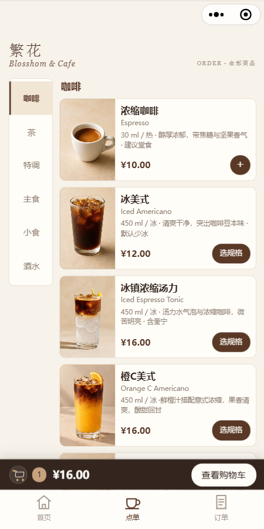
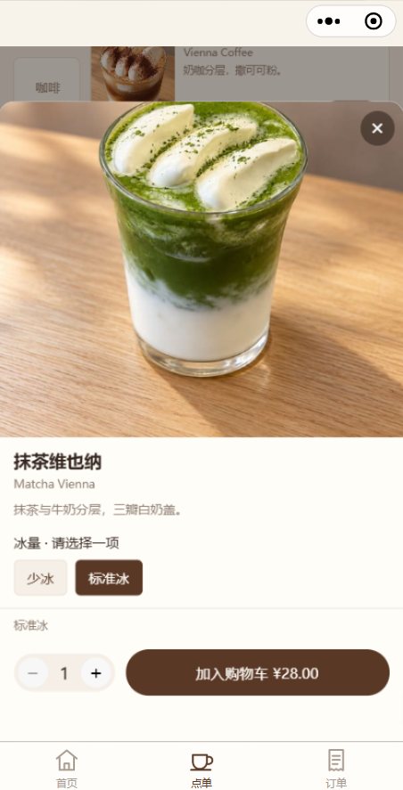
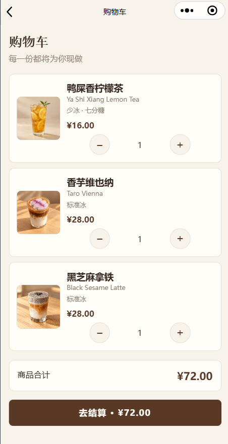
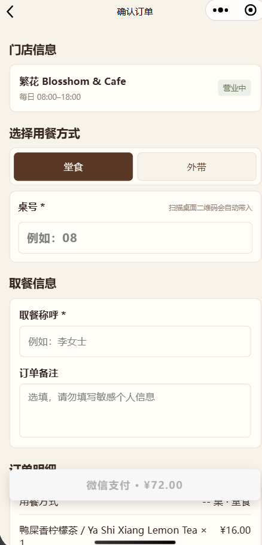

# Blosshom & Café｜微信扫码点餐项目

面向实体咖啡门店，实现桌码点餐、商品规格、微信支付、订单查询和支付后云打印。

- [项目说明、架构图与运行步骤](blosshom-cafe-miniprogram/README.md)
- [芯烨云打印部署](blosshom-cafe-miniprogram/docs/xpyun-deployment.md)

## 效果展示

| 菜单浏览 | 规格选择 |
| :---: | :---: |
|  |  |

| 购物车 | 确认订单 |
| :---: | :---: |
|  |  |

截图日期：2026-11-01。价格与营业信息以当前门店配置为准。

源码位于 `blosshom-cafe-miniprogram/`。生产密钥和真实订单数据不属于仓库交付内容。源码更新与小程序正式发布是独立操作。
