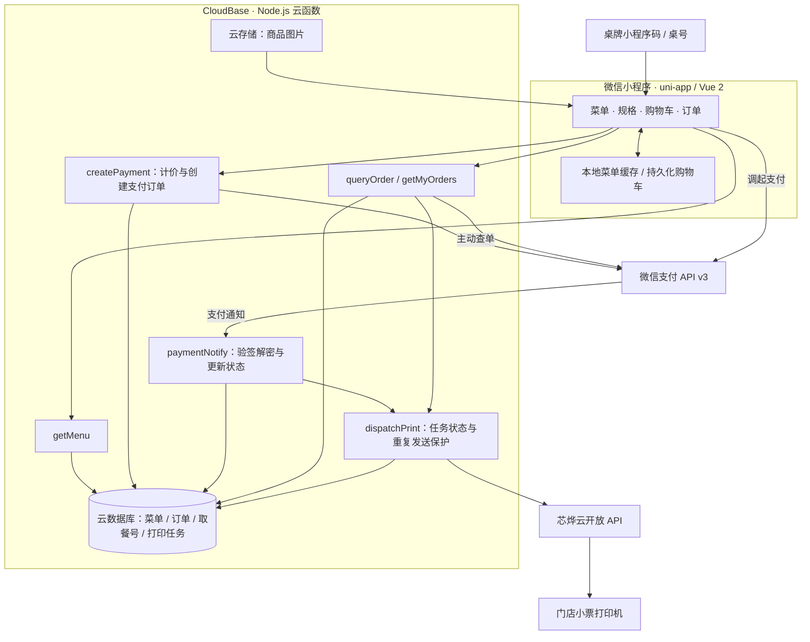

# Blosshom & Café｜门店扫码点餐小程序

面向实体咖啡门店，连接桌码点餐、商品规格、购物车、微信支付、订单查询和支付后自动打印小票。采用 uni-app + Vue 2 客户端与腾讯云 CloudBase Serverless 后端。

> 本仓库为源码与部署资料，不含生产数据库及支付、打印密钥。源码更新不等于微信正式版已发布。加载优化需继续真机验收，不宣称未经测量的性能提升。

## 功能

- 桌牌小程序码 scene / 桌号解析，堂食与外带信息。
- 云端菜单分类、价格、排序、图片、上下架与售罄管理；冰量、糖分、茶底等商品规格。
- 按规格区分的持久化购物车、商品图片、订单查询和取餐号。
- 服务端重新计价、校验规格与售罄状态，保存订单商品快照；微信支付 API v3 / JSAPI 接入。
- 支付通知验签、解密和金额匹配，主动查单与重复请求复用；不以前端付款回调作为最终支付依据。
- 芯烨云自动打印：任务状态记录、条件更新控制并发发送；结果不确定时标记 UNKNOWN 待核查，不盲目重打。
- 缓存菜单先展示、后台更新、图片地址短期复用、非当前分类图片懒加载；刷新期间保留已显示图片。

## 架构图



打印失败不回滚已成功付款；SENT 表示平台接受打印任务，不等同于确认纸张已打印完成。

## 技术栈

| 层次 | 技术 |
| --- | --- |
| 客户端 | uni-app、Vue 2、JavaScript、微信小程序 |
| 服务端 | Node.js、CloudBase 云函数、wx-server-sdk |
| 数据与图片 | CloudBase 云数据库、云存储 |
| 外部服务 | 微信支付 API v3、芯烨云 API |
| 验证 | Jest、微信开发者工具、真机与打印机联调 |

## 运行

进入本项目目录，使用与现有构建验证一致的 Node.js 环境；旧版 uni-app 构建链升级前需回归测试。

```bash
npm install
# 将 .env.example 复制为 .env.local，配置前端开关
npm test
npm run build:mp-weixin
```

微信开发者工具导入 `dist/build/mp-weixin`；监听构建使用 `npm run dev:mp-weixin`。

- `VUE_APP_USE_CLOUD=false`：内置演示菜单和明确标注的模拟支付，不扣款。
- `VUE_APP_USE_CLOUD=true`：填写自己的 `VUE_APP_CLOUDBASE_ENV_ID`；先部署安全规则、索引、云函数、支付回调及打印环境配置。
- 更换门店部署须检查代码与配置中的 AppID、商户号、环境 ID 和门店资料，不能沿用原门店参数。

## 目录与部署资料

```text
src/                  页面、服务层、购物车、规格与缓存工具
cloudfunctions/       菜单、支付、通知、查单、云打印
cloudbase/            导入模板、安全规则、索引
scripts/              构建兼容与桌码生成脚本
tests/                计价、购物车、支付安全、规格、缓存、打印测试
docs/                 功能发布和打印部署说明
```

参考：[CloudBase 部署](cloudbase/README.md)、[桌码与打印](docs/table-ordering-and-printing.md)、[芯烨云部署](docs/xpyun-deployment.md)、[规格发布](docs/product-specs-release.md)。历史文档存在阶段性方案，以当前代码和实际配置为准。导入模板不保证与生产菜单实时一致。

## 安全与边界

- AppSecret、支付私钥/API v3 密钥、UserKEY 仅配置在服务端环境变量或密钥管理；不得进入前端或 Git。生产订单与个人信息不提交。
- 离线缓存不作为可信价格来源，下单仍由服务端校验。
- 测试和编译通过不等于生产安全审计或稳定性保证；重复通知、弱网、打印缺纸等需要受控验收。
- 未提供完整商家接单后台、多门店、会员积分、优惠券、自动退款管理。

简历文字见 [项目说明](docs/resume-project.md)，按本人实际贡献调整，不填写未经测量的提速或经营指标。
